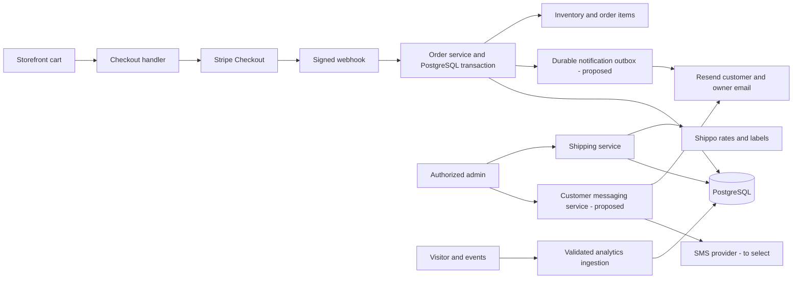

# Backend roadmap

Baseline: 2026-10-23 · Source commit: `21ff26dcce02bfae7e158ceeab363b608a1500f9`

## Goal and tracking

Manage payments, trustworthy analytics, shipping and purchased labels, plus the order/customer/newsletter data and messaging needed by admin. This source review records implementation evidence, not successful external transactions. **Present** = code exists; **Partial** = missing integration or safeguards; **Planned** = no complete implementation found. P0 addresses commerce correctness and authorization; P1 completes requested functionality; P2 addresses operations/scale. Checkboxes require acceptance evidence.

Related: [Frontend](frontend.md) for screens; [Libraries](lib.md) for shared business logic. The current backend is Next.js Route Handlers and server actions inside the storefront deployment, using Prisma 7.8 with the PostgreSQL adapter. Vercel is described in README; deployment health was not verified.

## Current architecture and gaps

| Objective | Status | Source evidence |
| --- | --- | --- |
| Checkout | Partial | `src/app/api/checkout/route.ts` validates IDs/integer quantities, combines duplicate IDs, enforces a 20-unit limit, reads database prices/stock, and creates USD Stripe Checkout with US address and phone collection. No persisted pending order, inventory reservation, visitor/session linkage, or explicit shipping/tax configuration. |
| Payment fulfillment | Partial | `src/app/api/stripe/route.ts` verifies raw-body Stripe signatures, handles paid `checkout.session.completed`, lists up to 100 line items, and emails the owner through Resend. It does **not** write Order/OrderItem/User, decrement inventory, close carts, or record PURCHASE events. No durable event deduplication. |
| Analytics collection | Partial | `/api/analytics/visitor` persists visitor/session cookies. Event handler file is `src/app/api/analytics/events/routes.ts` (plural filename), which does not register an App Router endpoint. Client sends to `/api/analytics/event` (singular path). |
| Analytics reporting | Partial | Admin analytics queries visitors/sessions/events, product funnel, campaign attribution, revenue, and charts. Session attribution fields exist but session creation does not populate them. Revenue needs orders that the current payment path does not create. |
| Shipping rates and labels | Partial | `src/app/api/shippo/route.ts` retrieves a paid Stripe session, validates parcel dimensions, requests Shippo rates, and purchases a `PDF_4x6` label. It has no admin authorization check or persistence; purchase accepts a rate ID without binding it to an authorized order. |
| Order and label storage | Present schema, disconnected writes | `prisma/schema.prisma`: Order/OrderItem/ShippingLabel, unique Stripe session/payment IDs, one label per order, tracking/cost fields. Shipping address is not stored in Order. |
| Newsletter capture/customer directory | Partial | Newsletter action normalizes/validates email, handles duplicates; admin merges users/orders/subscribers. Subscriber model has email/timestamps only: no subscription lifecycle or channel permissions. |
| Customer email/text | Planned | Resend is used for owner order alerts only. No customer messaging endpoint, SMS integration, delivery ledger, or unsubscribe workflow. |
| Admin mutation protection | Partial | Protected layout uses JWT cookie authentication, but product server actions have placeholder auth comments and Shippo does not call an admin guard. Layout protection does not replace authorization in mutations. |

## Target architecture

Keep route handlers thin: validate request, authenticate/authorize, call shared services, translate outcomes to HTTP. PostgreSQL owns order/customer state; Stripe owns payment confirmation; Shippo owns carrier label creation. Remote operations need retry/reconciliation because a database transaction cannot atomically commit a provider purchase.

## Delivery milestones

### B0 — Protect side effects · P0 · Partial

- [ ] **B0.1 Authorize every admin mutation.** Require verified admin sessions inside Shippo handlers and every product server action; enforce the same rule on future uploads/contact endpoints. Accept: unauthenticated and expired-session direct requests cannot mutate products, fetch customer shipping data, buy postage, or send messages. Depends on L1.
- [ ] **B0.2 Validate side-effect inputs.** Bound parcel units/dimensions, request sizes, rate/order identifiers and checkout abuse; return deliberate 400/409/503 responses. Add login/send/checkout throttling appropriate to deployment. Accept: malformed/oversized inputs cannot reach provider operations or leak provider internals.

### B1 — Payment-to-order correctness · P0 · Partial

- [ ] **B1.1 Persist checkout context.** Store a server-priced pending order or checkout attempt with item snapshots, currency, totals and visitor/session references; connect Stripe metadata and returned session ID. Resolve duplicate browser submissions using a checkout idempotency key. Accept: one attempt can be traced from browser to Stripe and database without trusting browser prices. Depends on L2/L3.
- [ ] **B1.2 Fulfill paid events transactionally.** Verify signature/payment state; durably deduplicate Stripe event IDs; reconcile the checkout/session; write paid order/items/customer/address snapshot; apply inventory changes once. Choose a stock reservation/expiry policy to prevent concurrent overselling and define handling for paid-but-unfulfillable orders. Accept: replayed and concurrent events create one order and one stock adjustment; insufficient stock triggers a visible recovery path; forged events make no changes.
- [ ] **B1.3 Separate notifications from payment persistence.** Save an outbox record in the order transaction and deliver owner/customer confirmations afterward through a durable worker/retry mechanism suitable for the hosting platform. Do not use unawaited background work in a request. Accept: a Resend outage does not lose the paid order or duplicate it; retries do not resend a completed notification. Depends on L6.
- [ ] **B1.4 Define payment lifecycle and totals.** Standardize statuses, refunds, expiration/cancel reconciliation, tax and customer-paid shipping policy. Current checkout does not configure shipping rates or automatic tax. Accept: admin revenue and item/shipping/tax/refund totals reconcile with Stripe test fixtures; payment and fulfillment states remain distinct.
- [ ] **B1.5 Add payment integration coverage.** Use signed test-mode webhook fixtures, database assertions, and provider stubs/test mode. Accept: successful payment, invalid signature, event replay, parallel fulfillment, delayed webhook, provider failure, and refund paths have recorded results. No existing test script was found in package.json.

### B2 — Connected, credible analytics · P1 · Partial

- [ ] **B2.1 Register one event contract.** Correct the handler filename/path and client target together; mount the tracker in the intended public layout after visitor initialization. Accept: real requests persist one expected navigation event; HTTP failures are observable. `AnalyticsTracker` is currently not mounted in the root layout. Depends on L2/F3.5.
- [ ] **B2.2 Connect the funnel.** Emit category/product views, cart changes and checkout starts; record PURCHASE from server-confirmed payment and NEWSLETTER_SIGNUP from successful first subscription. Current footer emits unsupported `NEWSLETTER_CLICK`. Do not allow browser-submitted PURCHASE to establish trusted revenue. Accept: a known journey produces the expected event sequence without duplicate purchases.
- [ ] **B2.3 Attribution and metric definitions.** Populate validated UTM/referrer/landing-page fields on session creation, associate checkout/order with session, define session expiry, reporting timezone and event-versus-session conversion denominators. Accept: a campaign-tagged visit links to a test paid order and dashboard totals match database fixtures.
- [ ] **B2.4 Data quality and retention.** Bound event payloads, reject malformed JSON cleanly, limit automated abuse, and define visitor/event retention and privacy behavior. Accept: malformed events do not become generic server errors; trusted commercial metrics cannot be inflated by arbitrary browser purchase events.

### B3 — Safe fulfillment and label lifecycle · P1 · Partial

- [ ] **B3.1 Persist rate/order relationship.** Use a local paid order and shipping-address snapshot; validate shipping origin/parcel and save a shipment/rate selection linked to that order. Accept: selected rates cannot be reused to purchase for an unrelated order. Depends on B0/B1/L4.
- [ ] **B3.2 Purchase and save labels safely.** Persist provider transaction, cost in minor units, label URL, tracking, carrier/service and status. Handle double clicks and network timeouts with a durable attempt plus provider reconciliation before buying again. Accept: concurrent/retried requests produce one charged label or an explicitly unresolved attempt, and admin can reopen the saved label.
- [ ] **B3.3 Track delivery and exceptions.** Add authenticated/provider-verified tracking ingestion or a scheduled reconciliation job, label failure handling, and a deliberate void/refund flow. Current schema permits only one label per order; decide how replacement/void history will be represented before supporting it. Accept: delivery/void changes are recorded without treating label creation as delivery.
- [ ] **B3.4 Test label printing.** Exercise Shippo test mode: paid-order rates, selection, purchase, persisted 4×6 PDF and tracking display. Accept: unpaid/unauthorized attempts fail; print output is a carrier label, distinct from the existing packing slip. Depends on F3.4.

### B4 — Newsletter and customer communication · P1 · Partial

- [ ] **B4.1 Subscription lifecycle.** Add channel-specific subscription status, consent provenance/timestamps, unsubscribe/suppression and normalized phone identity. Preserve existing newsletter emails without inventing historic SMS consent. Accept: newsletter-only contacts remain queryable; suppressed contacts are excluded from marketing. Depends on L5/L6.
- [ ] **B4.2 Customer email.** Reuse Resend through a shared adapter; add authorized send/preview, sender validation, per-recipient message history and provider delivery updates. Accept: a test email reaches an eligible customer and its provider ID/status is visible; retries avoid duplicates.
- [ ] **B4.3 Customer text.** Select an SMS provider (e.g. Twilio is a candidate, not an existing dependency), sender and inbound opt-out handling; use the same message ledger/eligibility policy. Accept: test SMS status and opt-out are recorded and later marketing sends are blocked. Provider credentials/sender setup are external prerequisites.
- [ ] **B4.4 Complete audience queries.** Repair customer pagination URLs in frontend and move merging/search/pagination toward bounded database queries as volume grows. Accept: all subscribers can be reached, purchase history links correctly, and eligibility is checked again at send time.

### B5 — Operational verification · P2 · Planned

- [ ] Add build/type/lint and focused integration checks to CI, migration deployment instructions, health/config diagnostics, structured provider/operation IDs, and retry/reconciliation monitoring. Accept: a clean environment can demonstrate checkout → paid order → label → customer notification, and failures can be traced without logging secrets or full customer payloads.

## Runtime dependencies and evidence limits

Required foundation: PostgreSQL `DATABASE_URL`, generated Prisma client and migrations. Payments: `STRIPE_SECRET_KEY`, `STRIPE_WEBHOOK_SECRET`; checkout base URL: `SITE_URL`/`NEXT_PUBLIC_SITE_URL` or deployment URL. Current webhook also requires `RESEND_API_KEY`, `HERBALUR_OWNER_EMAIL`, `ORDER_FROM_EMAIL` before processing events. Shipping: `SHIPPO_API_KEY`, Stripe key and `SHIP_FROM_*` address fields. Admin: `ADMIN_PASSWORD`, `ADMIN_SESSION_SECRET`. Store values securely; never add them to this roadmap.

Source inspection did not revalidate infrastructure. Prior onboarding recorded blocked Prisma/Google Fonts downloads, failed build and HTTP 500 from missing generated client, plus 9 lint errors/4 warnings. Treat these as earlier observations until rerun, not proof of current network/deployment state. Live payments, labels, email, SMS and production data were not exercised for this roadmap.

## Progress log

| Date | Milestone | Change / evidence | Remaining blocker | Owner / PR |
| --- | --- | --- | --- | --- |
| 2026-10-23 | Baseline | Routes, actions, schema and admin data flow reviewed | End-to-end fulfillment and test evidence absent | Unassigned |

Update status, acceptance checkboxes and this log in the same PR as each milestone. Include test mode/provider fixture and database results; do not mark complete from a successful HTTP response alone.
